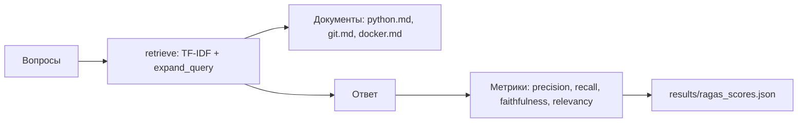

# RAG Evaluation with RAGAS

Оценка качества RAG-системы с помощью метрик, вдохновлённых RAGAS.

## Что внутри
- data/docs/ — документы (Python, Git, Docker).
- data/questions.json — 5 вопросов с эталонными ответами.
- src/evaluate_ragas.py — скрипт оценки.
- results/ragas_scores.json — метрики.

## Метрики
- context_precision — доля релевантных чанков в выдаче.
- context_recall — доля найденных релевантных чанков.
- faithfulness — насколько ответ опирается на контекст.
- answer_relevancy — насколько ответ релевантен вопросу.

## Как запустить
python3 src/evaluate_ragas.py

## Режимы
- Demo — упрощённые метрики без API (по умолчанию).
- Live — настоящий RAGAS с LLM-судьёй (требуется OpenAI API).

## Оценка

Скрипт `src/evaluate_ragas.py` считает 4 метрики на 5 вопросах:

| Метрика | Значение |
|---|---|
| context_precision | 0.867 |
| context_recall | 0.741 |
| faithfulness | 0.789 |
| answer_relevancy | 0.423 |

**Интерпретация:** после дополнения `python.md` (функции, исключения, циклы, импорт, классы, словари) `context_recall` вырос с 0.441 до 0.741 — RAG стал находить нужные чанки. `context_precision` снизился с 1.0 до 0.867: в топе больше чанков, и не все релевантны. Это классический компромисс precision vs recall.

## Ограничения

- Метрики упрощённые: `faithfulness` и `answer_relevancy` считаются по пересечению токенов, а не LLM-судьёй.
- `context_precision` снизилась после дополнения документов: RAG находит больше чанков, и не все релевантны.
- Для production нужно: заменить упрощённые метрики на настоящий RAGAS (LLM-судья), добавить `context_entity_recall`, `noise_sensitivity`.

## Архитектура

## Автор
redsea1970

## Архитектура

Подробная схема проекта: [ARCHITECTURE.md](ARCHITECTURE.md)
